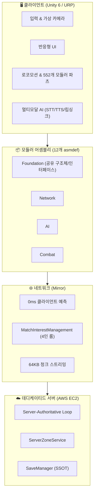

# MySecondWorld

**Unity 6 기반 크로스플랫폼 멀티플레이어 액션 RPG**
서버 권위 네트워킹, 온디바이스/클라우드 하이브리드 AI NPC, 대규모 모듈러 커스터마이징을 1인 개발로 구현한 프로젝트입니다.

📄 [상세 기술 문서 (Notion)](https://app.notion.com/p/2026-3d4c12defa4980f994a8da0cf10573a0?source=copy_link)
🎥 [플레이 영상 (YouTube)](https://youtube.com/playlist?list=PLbzoJ0fZJVF8&si=b4vfPgADLcIZXj6A)

-----

## 기술 스택

|분류       |기술                                              |
|---------|------------------------------------------------|
|엔진       |Unity 6, URP                                    |
|네트워킹     |Mirror Networking                               |
|서버 인프라   |AWS EC2 (Ubuntu, Linux Dedicated Server), Nginx |
|DI / 아키텍처|VContainer, 12개 asmdef 모듈화                      |
|비동기      |UniTask, R3                                     |
|AI       |LLM for Unity (llama.cpp, GGUF) · Groq Cloud API|

-----

## 아키텍처

### 4-Tier 구성

|계층                         |기술 스택                                           |역할                         |
|---------------------------|------------------------------------------------|---------------------------|
|① Presentation & Client    |Unity 6, URP, Cinemachine, New Input System     |크로스플랫폼 입력, 0ms 클라이언트 예측 렌더링|
|② Architecture & Modular   |VContainer DI, 12개 `.asmdef`, UniTask, R3       |단방향 의존성 강제, 순환 참조 원천 차단    |
|③ Network & Synchronization|Mirror, `MatchInterestManagement`, 64KB Chunking|공간 분할 트래픽 격리, 대용량 바이너리 스트리밍|
|④ Dedicated Server & Cloud |AWS EC2, Groq LPU, JSON Save                    |24/7 서버 권위 루프, 영속적 저장/AI 기억|

전체 레이어(11계층) 및 클래스 의존 관계 다이어그램은 [Notion 기술 문서](https://app.notion.com/p/2026-3d4c12defa4980f994a8da0cf10573a0?source=copy_link)에서 확인하실 수 있습니다.

-----

## 핵심 기능

1. **서버 권위 데디케이티드 서버** — AWS EC2 상시 구동 서버, 포탈 전환 시 씬 겹침·플레이어 증발 버그 구조적 해결
1. **552개 모듈러 파츠 커스터마이징** — 데디서버 렌더링 동기화 이슈(VContainer DI 주입 누락) 근본 해결
1. **공간 분할 매치메이킹** — `MatchInterestManagement` 기반 4인 룸 자동 인스턴싱 (마비노기 모바일 ‘우연한 만남’ 모티브)
1. **4축 모듈러 스킬 시스템** — Strategy + Composite 패턴, 12개 asmdef 순환 참조 해소
1. **온디바이스 LLM & 영속적 NPC 기억** — C++ P/Invoke 크래시(0xC0000005) 분석 및 방어, 씬 간 지속되는 NPC 기억 아키텍처
1. **실시간 대화면 공유** — Mirror 64KB 패킷 한계 극복(청크 슬라이싱), 이중 트리거 기반 관심 영역 관리

각 기능의 트러블슈팅 과정과 근본 원인 분석은 [Notion 기술 문서](https://app.notion.com/p/2026-3d4c12defa4980f994a8da0cf10573a0?source=copy_link)에 세션별로 상세히 기록되어 있습니다.

-----

## 개발 방식

1인 개발 환경에서의 아키텍처 붕괴를 방지하기 위해 매 기능마다 **사전 설계 → 구현/디버깅 → QA 검증 → 문서화** 4단계 프로세스를 지켰습니다.

-----

## Author

**배수현 (Bae Soohyun)**
Unity 게임 프로그래머 (클라이언트 / 서버)
